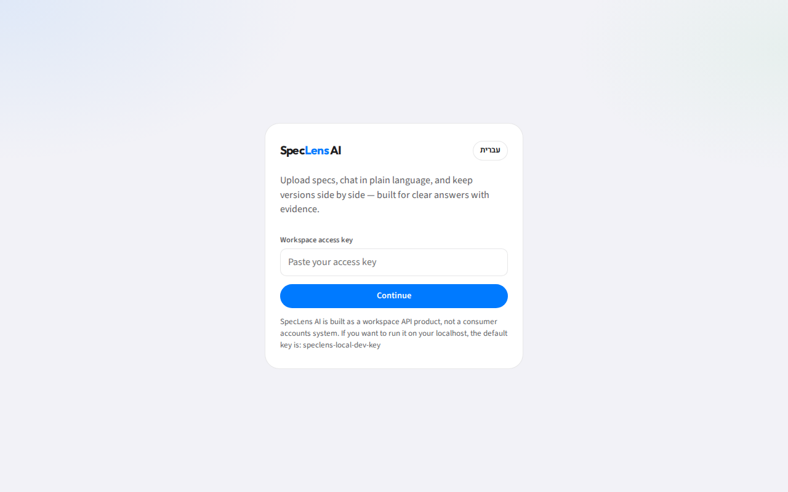
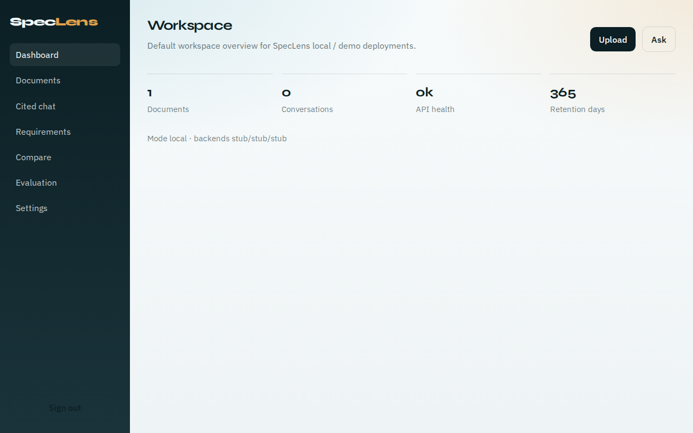
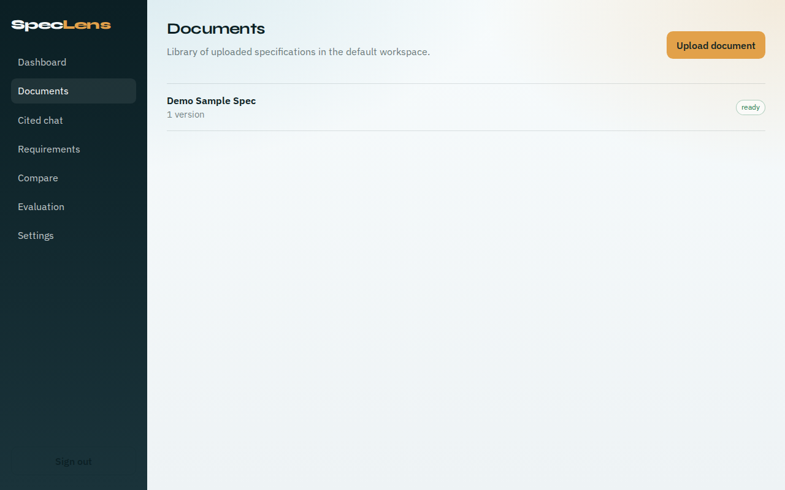

# SpecLens AI

Evaluation-driven AI platform for technical specifications: ingest large docs, retrieve with citations, extract structured requirements, compare versions, and measure quality offline before trusting model changes.

**Portfolio pack:** [`docs/portfolio/`](docs/portfolio/) — architecture diagram, write-up, screenshots, demo video.

## Stack

- **API:** FastAPI, SQLAlchemy 2, Alembic, structured JSON logging
- **Auth:** hashed API keys, workspace RBAC (owner/editor/viewer), rate limits, audit trail
- **Workers:** Celery + Redis (ingest, embed, extract, compare)
- **Retrieval:** stub/OpenAI embeddings, pgvector HNSW, FTS, hybrid RRF
- **QA / extract / compare:** cited conversations, structured requirements, version diffs
- **Eval:** offline JSONL harness + advisory CI gates (`make eval`)
- **Web:** React + Vite SPA (`apps/web`) — API key in `sessionStorage` only
- **Data:** Postgres 16 + pgvector; local filesystem object storage

Python **>= 3.12**. Node.js **>= 22**.

## Architecture


Browser SPA → FastAPI → Postgres / Redis / object storage, with Celery workers on the same data plane. Details: [`docs/architecture.md`](docs/architecture.md), ADR [`docs/decisions/0001-target-architecture.md`](docs/decisions/0001-target-architecture.md).

## Quick start

```bash
cp .env.example .env
make up          # postgres, redis, api, worker
make smoke       # health + ready
make web         # React UI → http://127.0.0.1:5173
```

Sign in with a workspace API key. Local/CI bootstrap key is documented in `.env.example` only — **rotate before any shared or hosted deploy**. Never commit real secrets.

Production-style stack (web on `:8080`): `make up-prod`. Ops: [`docs/deploy.md`](docs/deploy.md). Demo wipe + re-seed: `make demo-reset`.

API docs (local): http://127.0.0.1:8000/docs — authenticated routes need `Authorization: Bearer <key>`; `/health`, `/ready`, `/meta` stay public.

## Screenshots

| | |
| --- | --- |
|  |  |
|  | |

More media: [`docs/portfolio/`](docs/portfolio/).

## Make targets

| Target | Purpose |
| --- | --- |
| `make up` / `make up-prod` | Dev or prod-style Compose |
| `make smoke` | Health/ready checks |
| `make test` / `make lint` / `make typecheck` | Python quality |
| `make eval` | Offline eval harness |
| `make web` / `make web-build` | React app |
| `make demo-reset` | Reset default workspace + synthetic seed |
| `make contracts` | OpenAPI → TypeScript stubs |

## Evaluation & security

- Offline graders and thresholds: [`docs/evaluation.md`](docs/evaluation.md)
- Portfolio metrics summary: [`docs/portfolio/write-up.md`](docs/portfolio/write-up.md)
- Trust boundaries and checklist: [`docs/security.md`](docs/security.md)

**No confidential customer documents** are published. Demo corpus is synthetic fixtures under `services/api/tests/fixtures/` and generated eval JSONL.

## Individual contribution

Greenfield phased build (foundation → ingest → retrieval → cited QA → extraction → compare → eval → security → React UX/deploy → portfolio packaging), with stop-for-approval between phases and CI on each stacked PR.

## Prototype note

Local Docs Viewer (private offline DOCX viewer) is a UX/parsing reference only — its source is **not** copied into this repository. No LangChain dependency.

## License

Proprietary — private repository.
