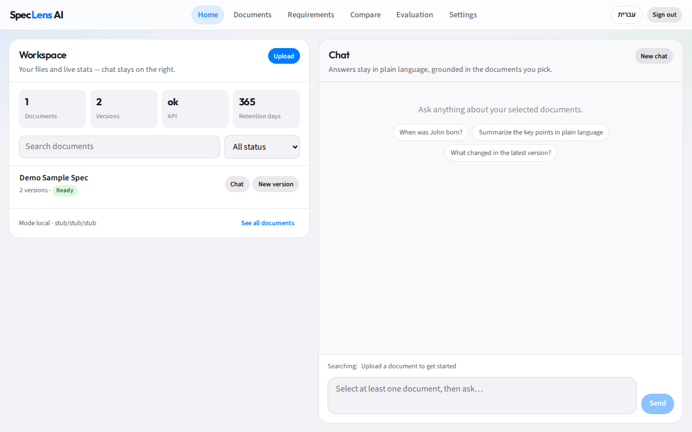
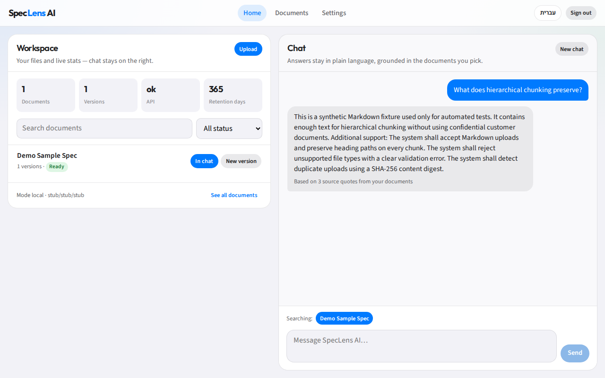

# SpecLens AI

**Working with a huge spec?** Word struggles to open it. Search never finds the exact clause. Scrolling forever isn’t a strategy.

**Load the file into SpecLens AI and chat with it** — answers stay grounded in the document, with citations you can check.

A full-stack portfolio project for technical specifications: upload Markdown/PDF/DOCX, chat in plain language (English or Hebrew), keep document versions, extract requirements, compare changes, and measure quality with offline evaluation gates.

| | |
| --- | --- |
|  |  |
|  |  |

[Architecture](#architecture) · [Quick start](#quick-start) · [Features](#features) · [Stack](#stack) · [Evaluation](#evaluation) · [Portfolio pack](docs/portfolio/) · [Security](#security--privacy)

---

## Why it exists

Big specs are painful in everyday tools: the file is too large to open smoothly, text editors and Word choke, and finding the one requirement you need is a scavenger hunt. Generic chatbots invent citations; spreadsheet extractions drift from source; version diffs are noisy.

SpecLens is the place you **load the file and ask** — with **evidence and eval gates** next to every AI step, so answers are inspectable, not magical.

## Features

- **Home workspace** — iOS-inspired split UI: document library + ChatGPT-style cited chat
- **Document ingest** — Markdown, PDF, DOCX → hierarchical chunks with heading paths
- **Hybrid retrieval** — vector (pgvector) + lexical FTS fused with RRF
- **Cited Q&A** — answers grounded in allow-listed chunk IDs (stub or real LLM)
- **Requirement extraction** — structured shall/must (and Hebrew modals) with provenance
- **Version compare** — align requirements across versions; ask “what changed?”
- **EN / HE UI** — language toggle with full RTL for Hebrew users
- **Offline eval harness** — retrieval, citation, extraction, compare, injection resistance
- **Security baseline** — hashed API keys, workspace RBAC, rate limits, audit, log redaction
- **Optional Gemini** — free-tier cited chat via OpenAI-compatible API (`openai_compat`)

## Architecture


Browser SPA → FastAPI → Postgres / Redis / object storage, with Celery workers on the same data plane.

Deep dive: [`docs/architecture.md`](docs/architecture.md) · ADR: [`docs/decisions/0001-target-architecture.md`](docs/decisions/0001-target-architecture.md)

## Stack

| Layer | Choice |
| --- | --- |
| API | FastAPI, SQLAlchemy 2, Alembic, structured JSON logging |
| Workers | Celery + Redis (ingest, embed, extract, compare) |
| Data | Postgres 16 + pgvector (HNSW + FTS), local filesystem object store |
| Web | React + Vite SPA — EN/HE i18n, session-only access key |
| LLM | Pluggable stubs **or** OpenAI / Gemini (`openai_compat`) |
| Quality | Ruff, mypy, pytest, Compose smoke, offline `make eval` |
| Runtime | Docker Compose (dev + prod-style); Python ≥ 3.12, Node ≥ 22 |

## Quick start

```bash
git clone https://github.com/adammatar/speclens-ai.git
cd speclens-ai
cp .env.example .env
make up          # postgres, redis, api (:8001), worker
make smoke       # health + ready
make demo-reset  # seed a synthetic demo document
make web         # React UI → http://127.0.0.1:5173
```

**Sign in** with the local workspace access key: `speclens-local-dev-key`  
(This is a SpecLens workspace gate — **not** your Gemini/OpenAI key. LLM keys stay in `.env` only; never commit them.)

| Useful URLs | |
| --- | --- |
| Web UI | http://127.0.0.1:5173 |
| API docs | http://127.0.0.1:8001/docs |
| Health | http://127.0.0.1:8001/api/v1/health |

Production-style stack (nginx web on `:8080`): `make up-prod`.  
Ops & Gemini setup: [`docs/deploy.md`](docs/deploy.md).

### Try Hebrew

1. Toggle **עברית** on sign-in or in the top bar  
2. Upload `demos/hebrew-john-biography.md` or `demos/hebrew-access-control-v1.md`  
3. Ask in Hebrew — answers follow the question language

## Evaluation

Offline graders run without paid LLM spend (stub backends + synthetic gold):

```bash
make eval
```

Latest harness snapshot (see caveat in the write-up):

| Metric | Value |
| --- | --- |
| Retrieval Recall@10 | 1.00 |
| Citation precision | 1.00 |
| Extraction F1 | 0.94 |
| Compare alignment | 1.00 |
| Injection resistance | 1.00 |

Full table + methodology: [`docs/portfolio/write-up.md`](docs/portfolio/write-up.md) · [`docs/evaluation.md`](docs/evaluation.md)

> Stub backends + synthetic fixtures inflate absolute scores vs production LLM traffic. The harness is for **regression control**, not marketing accuracy claims.

## Security & privacy

- API keys hashed at rest; cross-workspace access fail-closed  
- Rate limits + audit trail; logs redact secrets and document bodies  
- Complete delete removes DB rows and object bytes  
- **No confidential customer documents** in this repo — demos are synthetic  

Details: [`docs/security.md`](docs/security.md)

## Portfolio pack

| Asset | Path |
| --- | --- |
| Screenshots + walkthrough | [`docs/portfolio/`](docs/portfolio/) |
| Technical write-up | [`docs/portfolio/write-up.md`](docs/portfolio/write-up.md) |
| Architecture SVG | [`docs/portfolio/architecture.svg`](docs/portfolio/architecture.svg) |

Regenerate media: `make portfolio-media` (with API up + web preview on `:4173`).

## Project story

Greenfield phased build: foundation → ingest → retrieval → cited QA → extraction → compare → eval → security → React UX/deploy → portfolio packaging, with stop-for-approval between phases and CI on each stacked PR.

**Résumé line:** Built an evaluation-driven AI platform for technical specifications (Python/FastAPI, PostgreSQL/pgvector, React) — hybrid retrieval, cited answers, structured requirement extraction, document versioning, bilingual UI, and automated evaluation of retrieval quality and citation accuracy.

## Make targets

| Target | Purpose |
| --- | --- |
| `make up` / `make up-prod` | Dev or prod-style Compose |
| `make smoke` | Health/ready checks |
| `make test` / `make lint` / `make typecheck` | Python quality |
| `make eval` | Offline eval harness |
| `make web` / `make web-build` | React app |
| `make demo-reset` | Reset workspace + synthetic seed |
| `make contracts` | OpenAPI → TypeScript stubs |
| `make portfolio-media` | Playwright screenshots + demo video |

## License

© Adam Matar. Source is published for portfolio review. All rights reserved unless otherwise noted — contact the author for reuse beyond evaluation/interview purposes.
